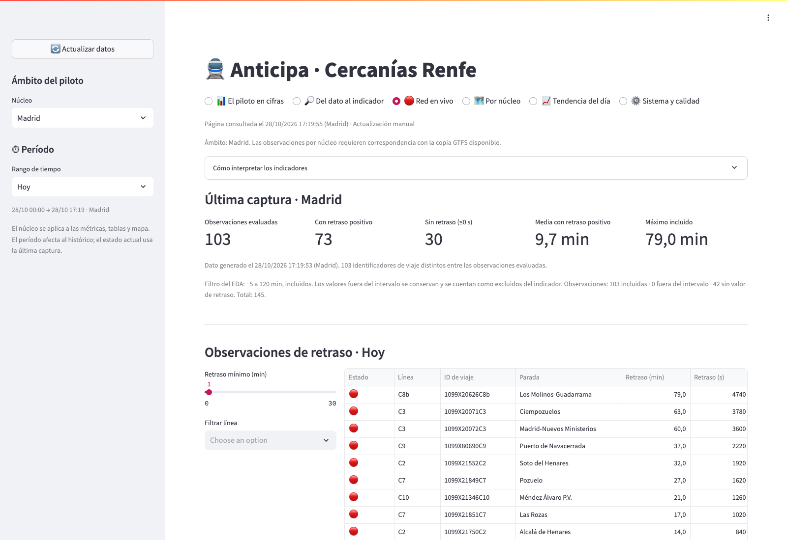

# Anticipa · Piloto de datos de Cercanías

Anticipa es un proyecto de TFM para explorar la captura, conservación y análisis de información de Cercanías Renfe. El cuadro de mando permite revisar el estado publicado por Renfe y demostrar cómo una observación pasa del mensaje original al indicador.

**Demo:** [cercanias.mikines.es](https://cercanias.mikines.es/). Es un prototipo académico. Los retrasos mostrados son estimaciones del proveedor; no acreditan llegadas reales ni resultados de un modelo predictivo de Anticipa.



## Recorrido de los datos

```text
Renfe GTFS-RT → descarga cada 30 s → original Protobuf (.pb)
             → parser → Parquet por fuente y fecha UTC
             → consultas DuckDB → cuadro de mando Streamlit
```

Fuentes: posiciones de vehículos, actualizaciones de viajes y avisos de [Renfe Open Data](https://data.renfe.com/), junto con el horario GTFS estático. Los endpoints y frecuencias se encuentran en `config.yaml`; el inventario completo de fuentes está en [FUENTES_DATOS.md](FUENTES_DATOS.md).

La descarga conserva una captura cuando cambia la fecha de la cabecera. Por tanto, una petición correcta cada 30 segundos no implica un archivo nuevo cada 30 segundos. El estado de la última descarga se conserva por separado de la fecha del proveedor, también cuando el contenido no cambia. Los Parquet se publican mediante sustitución atómica para evitar lecturas de archivos incompletos.

## Vistas

| Vista | Qué permite comprobar |
|---|---|
| El piloto en cifras | Archivos, filas, fechas, volumen y evolución de toda la red capturada. |
| Del dato al indicador | Una captura fijada o histórica: original, fila Parquet, cruce con GTFS, cálculo sin filtro y efecto del filtro analítico. Descarga de evidencias. |
| Red en vivo | Última captura, observaciones de retraso y estado de los avisos. |
| Por núcleo | Posiciones y desviación estimada por núcleo; comparación histórica ponderada por observaciones. |
| Tendencia del día | Porcentaje de observaciones sin retraso y mapa de desviaciones por parada. |
| Sistema y calidad | Servicios, disco, fecha de los datos, última descarga correcta, continuidad y comprobaciones de un día. |

Madrid es el ámbito inicial de las vistas analíticas. El selector se comparte entre esas vistas. El inventario y las comprobaciones de archivos abarcan todas las fuentes conservadas, no solamente Madrid. La actualización de la página es manual.

## Definiciones y límites

- Una fila de `trip_updates` es una observación de parada; un viaje puede aportar varias. Los recuentos de filas no equivalen a trenes únicos.
- Los indicadores analíticos incluyen valores de retraso entre **−300 y 7.200 segundos**, ambos extremos incluidos, siguiendo el criterio exploratorio del EDA. Se muestran los recuentos incluidos, fuera del intervalo y sin retraso. El bruto permanece íntegro y no se afirma que todos los excluidos sean errores.
- **Media positiva:** media de observaciones incluidas con retraso >0. **Desviación media:** media de todas las incluidas, con adelantos y retrasos. Las medias del período se ponderan por observaciones.
- **Sin retraso:** valores ≤0 segundos entre observaciones evaluadas. El semáforo visual utiliza 2 y 10 minutos como referencias; no modifica ese porcentaje. Algunos campos delay ausentes se almacenaron como cero por el parser; la trazabilidad los señala. Este porcentaje no valida puntualidad real.
- Si la última captura no tiene valores evaluables, se muestra «Sin datos», sin retroceder a otra captura ni sustituir medias ausentes por cero.
- Los datos y particiones se conservan en UTC. Las fechas de «Hoy», «Ayer» y los demás períodos de consulta se interpretan en `Europe/Madrid`, incluidos los cambios de hora. Los inventarios por día mantienen su referencia UTC explícita.
- Los avisos con fuente de más de diez minutos no se presentan como activos. Una fuente sin actualización no permite concluir que no haya incidencias. La descarga reciente y la vigencia se comprueban separadamente; el parser conserva el primer intervalo de cada aviso.
- Los intervalos sin snapshots no prueban una caída de Renfe. Se muestran completos y también intersectados con una ventana de referencia 05:30–00:30 de Madrid, que no sustituye el horario oficial de cada núcleo.
- Un original sin Parquet requiere inspección: la comprobación de un día distingue mensajes sin registros, con registros y no legibles. No reprocesa ni borra los archivos.
- El cruce GTFS usa la copia conservada disponible y no demuestra reconciliación histórica contra todas las versiones del horario ni cobertura de circulaciones planificadas.

Los indicadores K1–K5 completos, la latencia hasta el navegador y el rendimiento predictivo requieren validaciones específicas. Kafka, Spark y Airflow no forman parte de esta implementación del piloto.

## Ejecutar

Requiere Python 3.12 y acceso a los endpoints configurados. Desde la carpeta del proyecto:

```bash
python3 -m venv venv
source venv/bin/activate
pip install -r requirements.txt
python main.py
```

En otra terminal, con el mismo entorno:

```bash
streamlit run dashboard.py
```

La captura inicial prepara las fuentes estáticas. El dashboard necesita archivos Parquet de las tres fuentes. Los datos se guardan en `data/`, excluido del repositorio junto con cachés, estados, evidencias y copias de recuperación. Para reproducir cifras históricas hay que disponer del conjunto correspondiente y de su referencia GTFS; clonar el código no descarga todo el histórico.

Para generar o actualizar el inventario:

```bash
python -m src.pilot_inventory
```

El primer inventario recorre los archivos; las actualizaciones posteriores reutilizan particiones sin cambios. El botón «Actualizar datos» actualiza el inventario de la vista seleccionada. La preparación del ejemplo fijado se describe en [DEL_DATO_AL_INDICADOR.md](DEL_DATO_AL_INDICADOR.md).

### Prueba de concepto de predicción

`poc_prediccion_retraso.py` es un experimento separado del cuadro de mando. Sus dependencias adicionales se instalan con:

```bash
pip install -r requirements-ml.txt
```

Ejecutarlo requiere los datos y supuestos del experimento; su presencia en el repositorio no implica un modelo validado o desplegado.

## Pruebas

```bash
python -m pytest -q
```

Las pruebas usan mensajes sintéticos y conjuntos temporales pequeños, sin descargar ni necesitar el histórico del servidor. Cubren parser, escritura, deduplicación, inventario, selección de archivos, vistas, trazabilidad, filtros y denominadores, ámbito del núcleo, avisos, ventanas horarias y cambios de hora. La reproducción de capturas reales se verifica adicionalmente en «Del dato al indicador».

Documentación de las vistas: [Piloto en cifras](PILOTO_EN_CIFRAS.md), [Sistema y calidad](SISTEMA_Y_CALIDAD.md), [Del dato al indicador](DEL_DATO_AL_INDICADOR.md).

## Despliegue y conservación

Los archivos `cercanias-pipeline.service` y `cercanias-dashboard.service` describen el despliegue actual. Para una instalación nueva deben adaptarse las rutas y utilizar una cuenta de servicio sin privilegios. El proxy de Streamlit debe permitir WebSockets.

Antes de migrar la cuenta del servicio hay que preparar el acceso al código, entorno, datos y cachés fuera de `/root`. Antes de compactar o archivar datos hay que adaptar los lectores: actualmente el nombre de cada archivo identifica una captura y permite enlazar original y Parquet. Esta versión no cambia ni borra el histórico para ahorrar espacio.

Autoría y contexto académico: proyecto Anticipa, TFM EOI. Consulta también la memoria y los entregables del equipo para el alcance de cada sprint.
